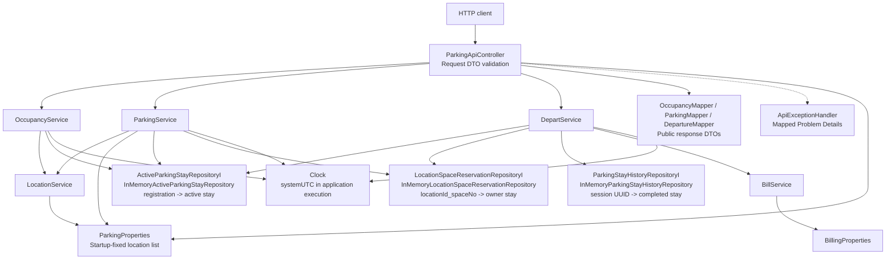
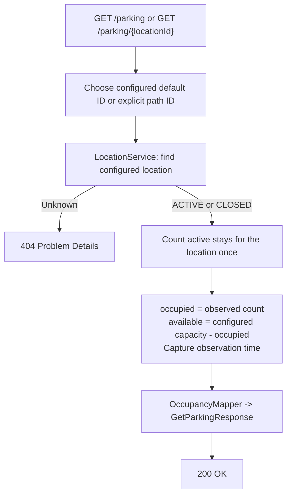
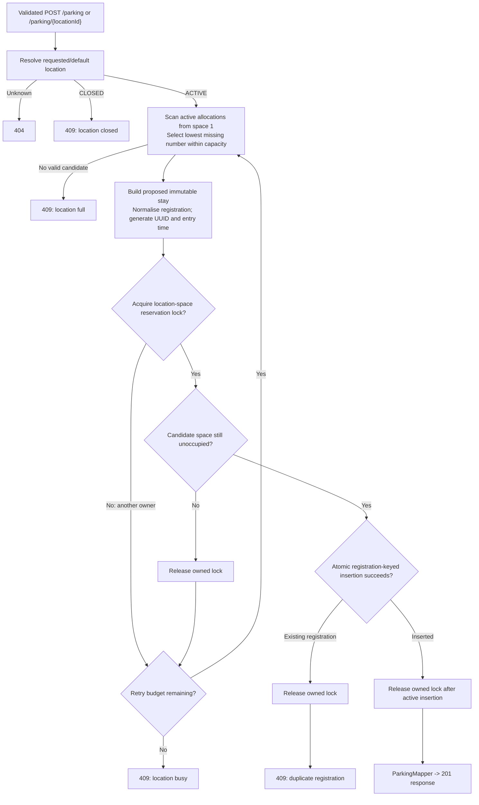
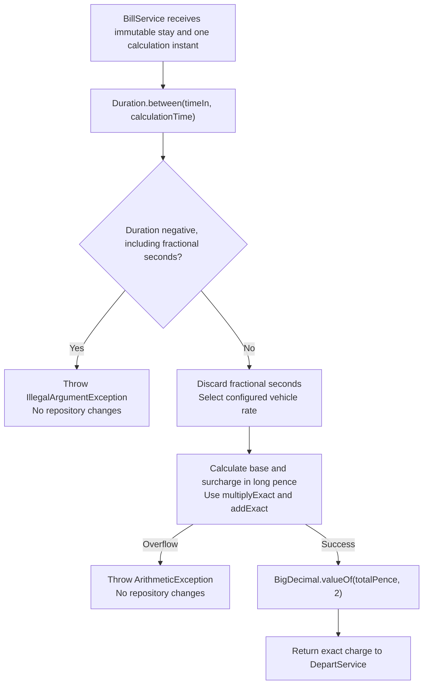
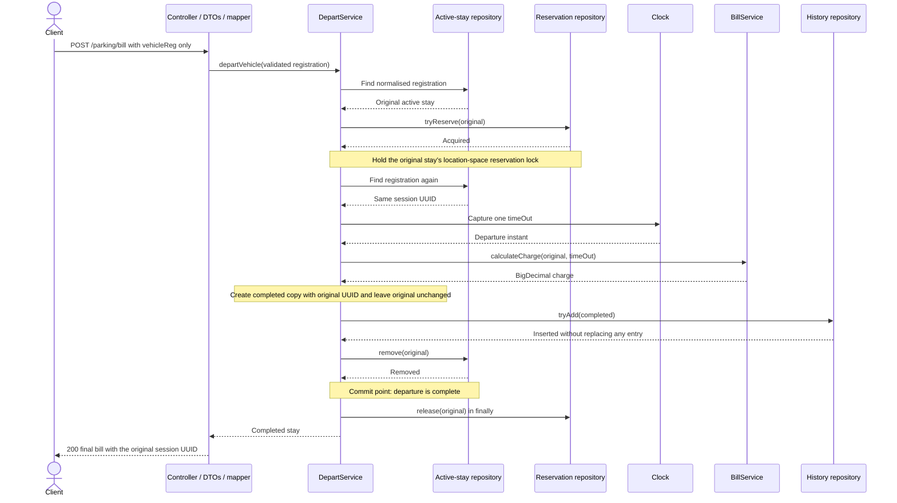
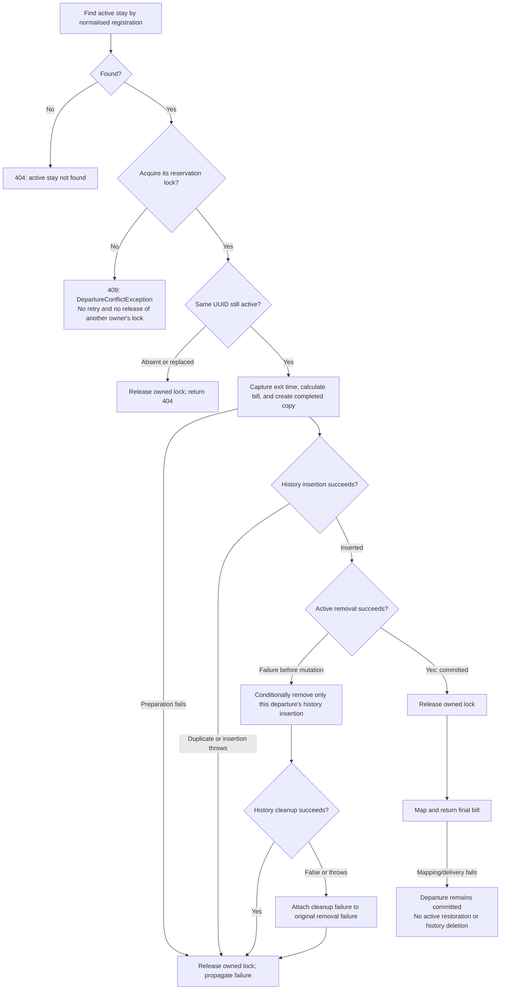
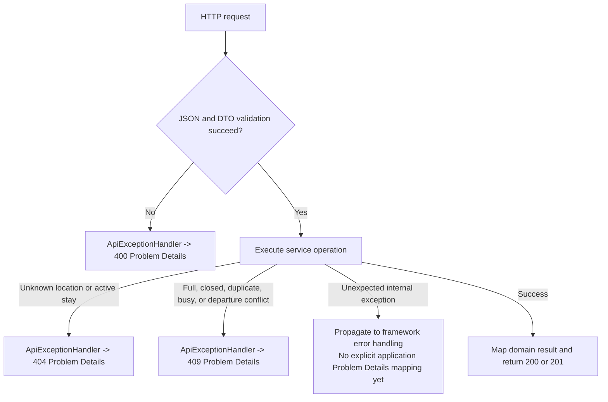

# Parking API — Solution Design and Closed Decisions

Date: 2026-11-09  
Status: current implementation and final take-home scope

This document describes my design for the Parking API, the decisions behind its implementation, and the alternatives I considered. The decisions are final for this submission. The Impact section identifies current limitations and possible future extensions.

## Context

{info}I built the car park API described in the take-home brief using a layered design, in-memory state, and tests at appropriate levels.{info}

### Brief requirements and implementation scope

The supplied three-page **Java Take Home Task Instructions** asks for allocation of the first available parking space, occupancy reporting, a final charge on exit, and release of the vehicle's space. It specifies three endpoints, in-memory storage rather than a persistent store, basic error handling, tests that provide confidence, and a README covering local setup, execution, and assumptions. Multiple simultaneous clients are an additional consideration; the initial solution may assume one request at a time. The suggested effort is 2–3 hours and the brief discourages over-engineering.

I chose an executable Java JAR with an embedded server for local execution. The brief does not require Docker, and the application runs without it.

| Area | Required by the brief | Closed decision for this implementation |
| --- | --- | --- |
| HTTP operations | `GET /parking`, `POST /parking`, `POST /parking/bill`; no query parameters | Preserve all three; add explicit-location GET and parking POST variants. |
| Allocation | First available space | Lowest missing valid space in the observed active allocations, with a protected recheck before insertion. |
| Charging | Small/medium/large: £0.10/£0.20/£0.40 per minute; an additional £1 every five minutes | Proportional whole-second base charge rounded down to pence, plus completed surcharge intervals. This resolves the brief's unspecified rounding. |
| Storage | In memory, not a persistent store | Three independent concurrent repositories for active stays, temporary reservations, and completed history. |
| Locations | No multi-location contract specified | One company per application instance, with startup-configured locations and a default location. |
| Responses | Occupancy counts; parking and final-bill data | Also expose session UUIDs, allocated space number, location ID and observation time where applicable. |
| History | No reporting or retention API required | Retain completed stays in unbounded, volatile history; no cleanup job in this submission. |
| Testing | Appropriate levels | Focused API-module tests and HTTP Cucumber acceptance tests in a separate module. |
| Packaging | Explain local setup and execution | Java 21, Maven Wrapper, and a Spring Boot executable JAR. Docker is omitted. |

### Current capabilities

Parking, occupancy, departure, billing, request validation, and the mapped business-error responses are implemented. Parking concurrency has five HTTP acceptance cases. Departure has one HTTP journey and focused service tests for ordering, rejection, and cleanup. Dedicated concurrent-departure HTTP coverage and additional configuration edge-case tests have been deferred to keep the take-home proportionate.

There are no payment operations, location-management endpoints, history-report endpoints, external service integrations, authentication, persistent storage, or background retention jobs.

## Proposed Solution Diagram

{info}These diagrams describe the implementation that exists now. All repositories are in-process memory stores; configured locations are not stored in a location repository.{info}

### Component responsibilities and dependencies



Repositories do not depend on one another. `DepartService` coordinates the repositories; `BillService` only calculates a charge. `LocationService` reads `ParkingProperties` directly, so a separate location repository is unnecessary.

### Workflow: occupancy



Both response counts derive from the same count, so they add up to capacity. Concurrent traversal is a live observation, not a transactionally consistent snapshot across all arrivals and departures. Temporary reservations and completed history do not count as occupied spaces.

### Workflow: parking



Each retry starts a fresh scan from 1. Candidate selection considers **active stays only**. Reservations cause acquisition conflicts and retries; they are not excluded during candidate selection and cannot establish fullness. Once acquired, the lock is released in `finally`, including when registration insertion throws. Unexpected acquired-lock failures also follow that cleanup path.

### Workflow: charge calculation



### Workflow: successful departure and billing



### Workflow: departure rejection and cleanup



An exception during release after active removal likewise does not undo departure. A repository removal operation must not mutate active storage and then report a pre-mutation failure. This is ordinary exception handling for the current in-memory implementation, not crash recovery or a durable transaction.

### Workflow: HTTP error reporting



Service cleanup happens before the exception reaches the controller advice. Formatting a response does not reverse storage operations.

## Key Decisions & Alternatives Considered

{info}The following decisions define my implementation. Each includes the alternatives I considered and the reasons for the final choice. Current limitations and deferred extensions are listed under Impact.{info}

### D01 — Layered Spring Boot application and explicit responsibilities

I chose Java 21 and Spring Boot 4.1.2. Controllers validate HTTP DTOs and invoke services; mappers produce public response DTOs; services own business flows; repositories encapsulate concurrent collections. I applied SOLID and DRY without introducing an interface for every service or a generic framework for every operation. `BillService` and `DepartService` remain separate.

| Alternative considered | Disposition and reason |
| --- | --- |
| Put validation, arithmetic, allocation, and storage in the controller | Rejected: mixes HTTP concerns with business and storage rules and makes focused tests harder. |
| A combined `DepartAndBillService`, or an extra `SpaceAllocationService` | Rejected: the selected `DepartService`, `BillService`, and existing `ParkingService` provide the required boundaries. |
| Spring Data REST, JPA entities, persistence DTOs, or MapStruct now | Deferred: no persistent store is required; small explicit mappers are sufficient. Domain records are not JPA entities. |
| Independently select versions for every managed library | Rejected: use Spring Boot dependency management where supplied; explicit project selections remain in the parent POM. |
| Java 17 or a newer JDK baseline | Not selected: Java 21 is the project/runtime baseline. |

### D02 — One company, configured locations, and numbered spaces

One application instance represents one company. It can serve multiple configured locations. A location has `id`, `name`, `maxCapacity`, and `status`; the implemented record has no description field. IDs are explicit configuration values independent of list position. Space numbers are integers from 1 through capacity. Every supported vehicle type can use every space; type changes the price, not allocation eligibility.

| Alternative considered | Disposition and reason |
| --- | --- |
| A single location only | Replaced by the selected multi-location extension while preserving default-location routes. |
| Multiple companies inside one process | Out of scope: tenant ownership, isolation, and authorisation are not needed for the brief. Separate instances have independent data. |
| Pre-create `ParkingSpace` objects | Rejected: numbered allocations and capacity express the required behaviour without another inventory model. |
| Vehicle-size space pools or physical fit checks | Rejected: no such rules were specified. |
| Generate location IDs from configuration order | Rejected: reordering the list must not change location identity. |

### D03 — Startup configuration, with no location repository

`ParkingProperties` binds a copied list of `ParkingLocation` records. `LocationService` resolves that list; it rejects unknown IDs and has a separate lookup that also rejects CLOSED arrivals. An ACTIVE location permits all implemented operations. A CLOSED location still permits occupancy queries and departure. Departure derives location and space from the captured stay and does not call `LocationService`.

| Alternative considered | Disposition and reason |
| --- | --- |
| A separate in-memory location repository | Rejected: the locations are fixed configuration, so another storage abstraction adds no required behaviour. |
| Runtime location creation, capacity changes, or status-management endpoints | Deferred: configuration is fixed until restart. |
| Reject every operation at a CLOSED location | Rejected: existing vehicles must still be able to leave and occupancy remains useful. |
| Continue accepting new parking at CLOSED locations | Rejected: closure must affect admission. |

### D04 — Public API contracts and mapping

All requests use the defined paths without query parameters. Occupancy and parking have default and explicit-location routes. Departure has one registration-only route for the globally active stay. The client does not supply location, space, entry/exit time, or session UUID in the departure body.

| Method and path | Input | Successful response |
| --- | --- | --- |
| `GET /parking` | None; use configured default location | `200`: `locationId`, `availableSpaces`, `occupiedSpaces`, `timeChecked` |
| `GET /parking/{locationId}` | Location path ID | Same occupancy response for the selected location |
| `POST /parking` | `vehicleReg`, `vehicleType`; default location | `201`: `parkingSessionId`, `vehicleReg`, `spaceNumber`, `timeIn` |
| `POST /parking/{locationId}` | Same body; location path ID | Same parking response for the selected location |
| `POST /parking/bill` | `vehicleReg` only | `200`: `parkingSessionId`, `vehicleReg`, `vehicleCharge`, `timeIn`, `timeOut` |

The implemented DTOs are `GetParkingResponse`, `PostVehicleParkRequest`, `PostVehicleParkResponse`, `PostVehicleDepartRequest`, and `PostVehicleDepartResponse`. The three mappers are `OccupancyMapper`, `ParkingMapper`, and `DepartureMapper`.

| Alternative considered | Disposition and reason |
| --- | --- |
| Expose the full `ParkingStay` directly | Rejected: location, space, and vehicle type belong in the complete domain/history record but not in the specified final-bill response. |
| Replace all original routes with required location paths | Rejected: preserve the brief's endpoints. |
| Use location headers, query parameters, or location fields in POST bodies | Rejected: explicit path variants express the optional location selection without changing the brief's request bodies. |
| Add `/parking/{locationId}/bill` | Replaced by the registration-only global departure contract; no separate location resolution is needed. |
| Require a request session UUID for departure | Rejected: the approved request targets the active stay captured by registration; the service rechecks its UUID internally. |
| Omit `spaceNumber` because the brief's example JSON omits it | Rejected: the endpoint description explicitly requests the allocated space number. |
| Return `204` after departure | Rejected: the operation returns a final bill, so success is `200`. |

### D05 — Validation at the HTTP boundary and normalised registration keys

Use Jakarta Bean Validation on request DTOs, triggered by `@Valid`. Raw registrations may contain whitespace and lowercase letters but must follow the chosen simplified format: 1–2 ASCII letters, 2–3 digits, then 1–3 ASCII letters, with permitted whitespace between characters. `@NotBlank` rejects missing, null, or blank registration. This is a selected application restriction, not a complete validator for every UK registration format or a requirement from the brief.

Services remove whitespace with `StringUtils.trimAllWhitespace` and uppercase with `Locale.ROOT` before using registration keys. DTO validation occurs before service normalisation; it does not require clients to send an already-normalised value. Production vehicle type is an `Integer` with `@NotNull`, `@Min(1)`, and `@Max(3)`.

| Alternative considered | Disposition and reason |
| --- | --- |
| Accept any non-blank ASCII alphanumeric registration | Not selected: this implementation uses the simplified letter/digit format described above. |
| Validate raw input against an uppercase-only pattern | Rejected: it would reject supported lowercase requests before normalisation. |
| Use raw registration keys or scan with `equalsIgnoreCase` | Rejected: normalised keys support direct lookup and atomic duplicate rejection across spacing/case variants. |
| Strip punctuation as part of normalisation | Rejected: invalid input must not silently become another registration. |
| Use primitive `int` for required production request vehicle type | Rejected: `Integer` distinguishes missing input for validation. Test-owned DTOs remain independent. |
| Ad hoc validation scattered through services/controllers | Rejected: declarative request constraints keep the HTTP boundary consistent. |

### D06 — Immutable session identity and lifecycle

Use one immutable `ParkingStay` record containing UUID, location, space, normalised registration, vehicle type, entry time, exit time, and final charge. An active stay has null exit time and charge. A completed copy retains the same session UUID and original fields and populates both completion fields. A zero charge is a populated charge. There is no stored ACTIVE/BILLED/PAID flag and no payment workflow.

Parking generates a random UUID and entry instant for each proposed attempt; the successful proposal becomes the active session. Failed proposals are discarded. Departure never generates a replacement UUID. The UUID can identify a visit in responses and future tracing; structured session logging and HTTP correlation-ID infrastructure are not implemented.

| Alternative considered | Disposition and reason |
| --- | --- |
| Mutate the active object during billing | Rejected: immutable completion avoids partially billed shared objects and active-object restoration. |
| Separate active and completed record classes | Not selected: one record and explicit service construction are sufficient for this scope. |
| Store a separate status flag | Rejected: it duplicates lifecycle fields and can disagree with them. |
| Identify a visit only by registration or generate a new UUID at departure | Rejected: returning vehicles have distinct visits; departure must retain visit continuity. |
| Seed UUID generation manually or derive identity from registration/time | Rejected: `UUID.randomUUID()` provides practical uniqueness without application seeding or deterministic input coupling. |
| Add lifecycle factory methods to enforce record invariants | Deferred: services construct records directly. The record itself does not reject inconsistent arbitrary construction. |

### D07 — Independent repositories and active-registration uniqueness

Repositories manage only their own collection. Services hold the cross-repository operation boundary. Active stays use one global `ConcurrentHashMap<String, ParkingStay>` keyed by normalised registration, enforcing at most one active stay per vehicle across every location in this instance. `tryAdd` uses `putIfAbsent`: empty means inserted, present means the existing stay was retained. Removal uses `remove(registration, expectedStay)`.

| Alternative considered | Disposition and reason |
| --- | --- |
| Repositories call one another | Rejected: tightly couples storage implementations and hides business coordination. `DepartService` coordinates the independent repositories. |
| Find registration, then perform an ordinary put | Rejected: concurrent requests can both pass a preliminary lookup. Atomic insertion establishes uniqueness. |
| Separate active maps per location or key active stays only by space | Rejected: these do not independently enforce global registration uniqueness. |
| Add a separate registration index or registration-lock registry | Rejected: the global active map already supplies direct lookup and atomic insertion. |
| Keep completed stays under the active registration key | Rejected: returning vehicles must be able to park again and have multiple historical visits. |
| Use ordinary mutable maps or service-owned shared collections | Rejected: concurrent repository operations and separation of storage from policy are required by the selected design. |

### D08 — Temporary location-space reservation locks

Use an initially empty `ConcurrentHashMap<String, ParkingStay>` keyed by the implemented string `locationId + "_" + spaceNo`. `tryReserve` uses `putIfAbsent`; its empty result means acquisition succeeded. The supplied proposed/active stay is also the ownership value. `release` uses `remove(key, expectedStay)`, so it cannot unconditionally remove another owner's entry.

The term **reservation lock** describes this map-based exclusion protocol. There is no `ReentrantLock`, waiting queue, or preallocated lock per space. Parking and departure use the same repository. A successful arrival is briefly present in both active and reservation maps; active insertion happens before lock release, so there is no unprotected transfer gap.

| Alternative considered | Disposition and reason |
| --- | --- |
| A global or location-wide lock | Rejected: serialises unrelated spaces or locations. |
| Locks keyed by vehicle type or different locks for parking and departure | Rejected: operations affecting the same space must exclude one another regardless of vehicle type or operation. |
| Preallocate a `ReentrantLock` for every configured space | Replaced: temporary entries avoid allocating coordination objects for every possible space. |
| A generic token object, structured space-key type, or nullable ownership tracker | Not needed in the selected implementation: the stay is the owner value and each acquired-lock scope has its own `finally`. |
| Check for a reservation and then insert separately | Rejected: only atomic acquisition closes the race. |
| Release by key alone | Rejected: release must match the owner stay. |

### D09 — Candidate selection, bounded retries, and accepted concurrency guarantees

Search active allocations from 1 and choose the lowest missing valid space. Reserve it, recheck active occupancy, and atomically insert the same proposal by registration. Both reservation conflicts and post-acquisition occupancy conflicts use one retry budget. The configured value is 5 retries, meaning one initial attempt plus up to five retries. Exhaustion produces `LocationBusyException`, not `LocationFullException`.

| Alternative considered | Disposition and reason |
| --- | --- |
| Exclude temporary reservations while selecting candidates | Explicitly rejected: active stays alone determine the candidate; temporary ownership is handled by acquisition and retry. |
| Treat reserved but inactive spaces as full | Rejected: only active allocations establish fullness. |
| Retry forever or maintain separate retry budgets | Replaced by one configurable bound shared by both conflict paths. |
| Advance an offset after a conflict | Rejected: each retry restarts a fresh scan from 1. |
| Guarantee the absolute lowest free space at the exact insertion instant | Rejected: that would require stronger coordination across concurrent departures. The guarantee concerns observed allocations and the protected final recheck. |
| Guarantee fairness or higher throughput through finer locking | Not selected: contention, rescanning, and bounded retries affect results; performance has not been benchmarked. |

### D10 — Derived occupancy without stored counters

`OccupancyService` resolves the configured location, counts matching active stays once, derives availability from capacity, and records a `timeChecked` instant. The observation is not used as an allocation reservation or stored for subsequent requests.

| Alternative considered | Disposition and reason |
| --- | --- |
| Store available/occupied counters or cache occupancy | Rejected: duplicates the active-stay state and adds consistency/invalidation obligations. |
| Count available and occupied independently | Rejected: concurrent changes can make independent observations disagree. |
| Lock an entire location to produce a snapshot | Rejected: live observational reporting is sufficient; admission is protected separately. |
| Use a previous free-space count to authorise insertion | Rejected: the candidate's protected recheck and insertion determine admission. |

### D11 — Charging arithmetic and public numeric representation

Use the non-negative whole seconds from `Duration.between(timeIn, calculationTime)`. Reject a negative duration before truncation, including a negative fraction of a second. Use `long` pence, multiplying before division and checking multiplication/addition overflow.

```text
basePence      = (seconds * ratePencePerMinute) / 60
surchargePence = (seconds / intervalSeconds) * intervalChargePence
totalPence     = basePence + surchargePence
charge         = BigDecimal.valueOf(totalPence, 2)
```

Both divisions round down for non-negative inputs. `BillService` returns `BigDecimal`, and history retains that exact amount. `DepartureMapper` converts the final value to `Double` only for the public `vehicleCharge` field, matching the brief. JSON need not preserve two trailing decimal places; internal currency arithmetic is not floating-point arithmetic.

| Duration | Small | Medium | Large |
| --- | --- | --- | --- |
| 0 seconds | £0.00 | £0.00 | £0.00 |
| 59 seconds | £0.09 | £0.19 | £0.39 |
| 1 minute | £0.10 | £0.20 | £0.40 |
| 4 minutes 59 seconds | £0.49 | £0.99 | £1.99 |
| 5 minutes | £1.50 | £2.00 | £3.00 |
| 9 minutes 59 seconds | £1.99 | £2.99 | £4.99 |
| 10 minutes | £3.00 | £4.00 | £6.00 |

Midnight and 24-hour boundaries do not reset charging. For example, a small-car stay of 25 hours is £450.00 with the supplied rates. Duration is elapsed time between instants, not a time-of-day subtraction.

| Alternative considered | Disposition and reason |
| --- | --- |
| Charge only completed minutes or round started minutes up | Rejected: does not implement the selected proportional whole-second rule. |
| Truncate a per-second rate before multiplying | Rejected: repeating fractions cause incorrect results, including 9p rather than 10p at one minute. |
| Round fractional pence to nearest or up | Rejected: the selected base-charge rule rounds down. |
| Charge a surcharge for started intervals or derive it from rounded minutes | Rejected: only completed intervals of actual whole elapsed seconds count. |
| Perform money calculations with binary floating point or `Float` | Rejected: avoid monetary rounding errors. The final documented `Double` representation is a boundary conversion only. |
| Perform every intermediate operation with `BigDecimal` | Not needed: integer arithmetic directly expresses the rounding policy. |

### D12 — Configured pricing and one supplied calculation instant

`BillService` receives `BillingProperties` and a calculation instant supplied by its caller; it reads neither repositories nor the clock. `DepartService` captures one exit instant after acquiring the reservation lock and confirming UUID. It uses that same instant for calculation, completed history, and the response. Production time comes from the shared `Clock.systemUTC()` bean, and timestamps are `Instant` values rendered as ISO-8601 UTC timestamps.

Required configuration imports are `parking.properties` and `billing.properties`. Defaults are:

| Property | Default |
| --- | --- |
| `parking.default-location-id` | `1` |
| `parking.maxReservationRetryAttempts` | `5` retries |
| `parking.locations[0].id` | `1` |
| `parking.locations[0].name` | `TDS Car Park 1` |
| `parking.locations[0].max-capacity` | `10` |
| `parking.locations[0].status` | `ACTIVE` |
| `billing.small-rate-pence-per-minute` | `10` |
| `billing.medium-rate-pence-per-minute` | `20` |
| `billing.large-rate-pence-per-minute` | `40` |
| `billing.interval-seconds` | `300` |
| `billing.interval-charge-pence` | `100` |

`BillingProperties` has startup validation: rates and interval charge are non-negative, and interval seconds is at least 1. Locations, pricing, and retry configuration are startup inputs rather than a runtime management API. Spring configuration supplies overrides; services do not read environment variables directly.

| Alternative considered | Disposition and reason |
| --- | --- |
| Hard-code rates or calculate charges inside `DepartService` | Rejected: configured inputs and a separate calculator keep arithmetic independently testable. |
| Direct environment-variable/file reads inside the calculator | Rejected: configuration binding supplies typed values before business operations. |
| Use `locations.properties` and a `parking.charging.*` prefix | Not selected: `parking.properties` groups locations and parking retries; `billing.properties` and the `billing.*` prefix group pricing separately. |
| YAML or all settings in one application file | Not selected: separate properties files group the concerns while retaining one import entry point. |
| Optional imports | Rejected: expected configuration files are required at startup. |
| Read system time in every operation or store local date-times | Rejected: injected time and UTC instants support deterministic, unambiguous duration calculation. |
| Capture different times for billing, storage, and response | Rejected: one instant prevents discrepancies. |
| Dynamic pricing/versioning or runtime location changes | Deferred: unnecessary for the current brief; restart already clears process state. |

### D13 — Departure reservation and session recheck

Departure first finds the normalised registration, then attempts to acquire the captured stay's location-space reservation lock. Failure returns `DepartureConflictException` immediately, without retrying or releasing the other owner's lock. The competing operation need not be another departure or concern the same vehicle. The client message therefore describes the parking session's inability to complete, without exposing internal location-space details:

> The parking session cannot be completed at this time because of a concurrent operation. Please try again.

After acquisition, re-read the registration and compare its session UUID with the original. An absent or replaced session returns `ActiveStayNotFoundException`, releasing the acquired lock. Once confirmed, the service holds the lock through bill preparation, history insertion, and active removal.

| Alternative considered | Disposition and reason |
| --- | --- |
| Use parking's retry policy for departure | Rejected: departure returns an immediate conflict so the client can decide whether to retry. |
| Assume the initial lookup still identifies the current stay | Rejected: the original stay can disappear or be replaced before acquisition. |
| Compare only registration or space | Rejected: those can be reused by later sessions; UUID identifies the captured visit. |
| Re-resolve or reject the stay's configured location | Rejected: location and space come from the active stay, and closure must not block departure. |
| Name the exception `DepartureInProgressException` or `VehicleOperationInProgressException` | Replaced by `DepartureConflictException`: the failure is acquisition for this departure, not proof that the other operation is a departure or targets this vehicle. |
| Say another operation is in progress “for this vehicle” or “for this parking space” in the HTTP detail | Replaced: the first can be misleading, while the second exposes an internal coordination detail absent from the request. |
| Add a normal changed-session branch at active removal | Rejected: the UUID recheck and held reservation establish the protected stay; removal failure is an internal failure path, not another routine lookup outcome. |

### D14 — Departure commit boundary and ordinary failure cleanup

The departure flow is: validate and normalise input; find active stay; acquire its lock; confirm UUID; capture one exit instant and prepare the completed copy; insert history; remove active; release the lock; return the bill. Active removal is the commit point.

| Failure point | Required action and implemented behaviour |
| --- | --- |
| Initial active lookup | Return 404; do not acquire a lock or change storage. |
| Lock acquisition conflict | Return 409; do not retry or release another owner's entry. |
| UUID recheck, time capture, or bill preparation | Release the owned lock; no history insertion or active removal has occurred. |
| Duplicate history UUID or history insertion exception | Release the owned lock; do not remove active or delete pre-existing history. |
| Active removal returns false or throws before mutation | Conditionally remove only this request's inserted completed record; release the lock; propagate the removal failure. |
| History cleanup also returns false or throws | Keep the original removal exception and attach cleanup failure as a suppressed exception; still attempt lock release. |
| Active removal succeeds | Keep completed history and leave registration available for another arrival. Do not restore active state. |
| Release, response mapping, or delivery fails after commit | Report/propagate failure as applicable, but do not delete history or reinsert the departed stay. |

| Alternative considered | Disposition and reason |
| --- | --- |
| Remove active first, then attempt fallible bill preparation/history insertion | Rejected: failure could release the vehicle before its completed record exists. |
| Mutate active and keep a backup for restoration | Rejected: immutable completed copies leave the original untouched before removal. |
| Separate history lock, exclusive history access, whole-history copying, or reversible history handles | Explicitly rejected: different UUID insertions use concurrent repository operations, and cleanup targets only the owned insertion. |
| Spring `@Transactional` or a custom transaction manager for plain collections | Rejected: annotations alone do not roll back map changes; a custom framework is disproportionate. |
| Undo departure after response mapping/delivery fails | Rejected: storage has already committed, and a later arrival may reuse the registration/space. |
| Treat HTTP error formatting as rollback | Rejected: service-level ordering and explicit cleanup preserve the state contract. |

### D15 — Unbounded UUID-keyed history for the take-home

Completed history is one `ConcurrentHashMap<UUID, ParkingStay>`. Its repository provides UUID lookup, non-overwriting insertion, and conditional removal. Different visits can share registration, location, or space but have different UUIDs. No capacity, FIFO order, expiry, background clearing, file export, or history endpoint is implemented.

| Alternative considered | Disposition and reason |
| --- | --- |
| No completed history | Not selected: retaining the completed session supports the chosen departure lifecycle and future reporting. |
| Shared bounded queue, or a bounded deque per location with default capacity three times parking capacity | Replaced by the unbounded take-home policy: eviction during insertion creates additional rollback effects. |
| `LinkedBlockingDeque`, `ConcurrentLinkedDeque`, `ArrayDeque`, or an insertion-ordered `LinkedHashMap` | Not selected for history: the settled operations are direct UUID lookup/insertion and owned-entry cleanup, rather than FIFO retention. |
| A separate history UUID index, nested registration histories, or per-location history maps | Not needed: one UUID-keyed map supports repeat visits and concurrent independent insertions. |
| An automatic evicting queue or manual capacity check, save victim, and restore on failure | Rejected for this slice: individually safe queue operations do not make eviction and restoration atomic; concurrent rollbacks can alter ordering or lose another record. |
| Per-location history locks or entire-history restoration to support bounds | Rejected along with the earlier retention design. |
| Scheduled age-based Quartz cleanup | Deferred future work: separates retention from departure and avoids insertion-time eviction. |
| Soft record limits, per-location limits, or separate location-filtered Quartz jobs | Deferred options: eventual cleanup targets, not guaranteed hard capacity limits. |
| CSV/log-based history or durable audit storage | Deferred: adds persistence, retention, and I/O behaviour beyond this in-memory submission. |

Future cleanup would measure age from `timeOut`, distinguish retention age from job frequency, and coordinate with in-progress departures so it cannot remove uncommitted history. Exact schedules, calendar-month semantics, thresholds, and coordination implementation have not been selected because no such job is part of the delivery.

### D16 — Business rejection status and Problem Details

`ApiExceptionHandler` maps the following failures to Spring `ProblemDetail`. Clients receive `application/problem+json` with status, title, and explanatory detail. Request-validation detail is currently a general message, not a field-error extension.

| Outcome | HTTP status | Current detail |
| --- | --- | --- |
| Invalid request fields | 400 | `Request fields failed validation` |
| Malformed JSON or wrong JSON field types | 400 | `Request body must contain valid JSON with the expected field types` |
| Unknown configured location | 404 | Identifies the missing location ID. |
| No active stay or captured UUID replaced | 404 | Identifies the normalised vehicle registration. |
| Already active registration, full/closed location, or exhausted parking retries | 409 | Explains the specific duplicate, full, closed, or busy condition. |
| Departure reservation-lock conflict | 409 | The session-completion message recorded in D13. |

`409` describes a conflict with the current resource state; it does not imply that two simultaneous requests are necessary. A full location is therefore a conflict even in sequential execution. A later repeated departure normally returns 404 because its active stay has been removed. A request that captured an old stay but later encounters another lock owner can instead return 409; timing and the protocol determine the outcome.

| Alternative considered | Disposition and reason |
| --- | --- |
| A custom error-envelope format | Rejected: use Spring's standard Problem Details representation for mapped errors. |
| Return an old receipt when departure is repeated | Rejected: departure completes an active stay; historical receipt retrieval is a different operation. |
| A `409` body that identifies a particular competing vehicle/operation | Rejected: acquisition failure does not establish those facts. |
| Add field-specific validation extensions and explicit Problem Details handlers for every internal failure | Deferred: current handlers cover the cases above; internal-failure handling is documented under Impact. |

### D17 — Test layers, test-first slices, and independent DTOs

I used JUnit 5 and AssertJ for API-module tests, MockitoExtension for mocked service dependencies, and Cucumber for externally observable HTTP journeys. Tests exercise public interfaces. Test methods precede private helpers, parameterised sources explain their inputs, and assertions use readable field extraction. I developed the application in small test-first slices: establish an executable failure, implement the behaviour, and refactor with passing tests. The commit history includes a deliberately failing departure acceptance scenario followed by the implementation that makes it pass.

| Alternative considered | Disposition and reason |
| --- | --- |
| Duplicate every rule at unit, HTTP integration, and acceptance levels | Rejected: test each concern at a level that gives useful confidence without repeating entire suites. |
| Mock real application services/repositories in acceptance tests | Rejected: acceptance requests must exercise the real application path. Use mocks for focused service failure paths. |
| Reflection/private-method tests, repository spying, or pauses inside application operations | Rejected: they test implementation interleavings rather than the public behaviour. |
| Treat mocked conflict responses as proof of concurrency correctness | Rejected: unit tests cover decisions and cleanup; real concurrent HTTP cases cover competing requests. |
| Share production DTO classes with the HTTP acceptance client | Rejected: independent test-owned DTOs prevent a server DTO change from silently changing the expected contract. |
| Add more departure/billing acceptance scenarios now | Deferred: one five-minute departure journey demonstrates the structure; boundary/failure cases are primarily covered by focused service tests. |

### D18 — Acceptance setup, shared steps, and deterministic event times

I structure acceptance tests around the following principles:

1. Arrange active stays through public parking HTTP calls, not direct domain/repository fixtures.
2. Express request fields and event timing as scenario inputs. Optional `timeIn`/`timeOut` table columns control the injected test clock before dispatch; they are not extra production JSON fields.
3. Reuse common steps and HTTP helpers. `AtHelper` supplies HTTP access and event timing, `ScenarioContext` owns shared results, `HttpResponseSteps` checks latest status/error details, and operation-specific classes check their own bodies.
4. Retain parking and departure responses separately for UUID/time comparisons, while updating the latest response for shared HTTP assertions. Record GET responses as well.
5. Derive expectations from scenario inputs and prior HTTP results. Capacity steps verify the supplied capacity through the API; occupancy is not read from repositories or production configuration objects.
6. Check rejected requests' status, Problem Details content type, status/title/detail, and expected rejection message. Check observable state afterwards through HTTP.
7. Keep internal cleanup and dependency-failure assertions in focused API-module tests; do not add diagnostic/reset/history endpoints solely for testing.
8. Keep concurrency execution and its rejection checks separate from normal parking/departure steps. Synchronise only HTTP starts, use bounded waits, and do not access scenario-scoped context inside workers.

The acceptance module starts Spring Boot in-process on configured port 8081, with a fresh context for every scenario and sequential scenario execution. A primary `AdjustableClock` uses an atomic shared instant; zone-specific copies share that instant. Ordinary application components still depend on `Clock`. The test harness controls time in-process, so these are real HTTP-boundary tests rather than tests against a completely external deployed process.

| Alternative considered | Disposition and reason |
| --- | --- |
| Arrange Given fixtures directly through repositories | Rejected: HTTP setup exercises the same request validation and service operations as an external client. |
| Expose clock-setting, reset, or failure-switch endpoints | Rejected: test orchestration must not change the public contract. |
| Feature steps that describe clock mechanics or wait in real time | Replaced by input event times and internal clock orchestration; no sleeps. |
| Change a shared clock while concurrent workers are running | Not selected: establish a common time before dispatch and leave it stable until workers finish. |
| Reuse one Spring context and clear/replace its collections | Rejected: creates reset obligations and stale-reference risks. Fresh contexts recreate all mutable state. |
| Target a manually started app, use Testcontainers, or parallelise scenarios | Not selected: direct context-managed startup on a fixed configurable port is sufficient and inspectable. |
| Random application ports | Not selected: a fixed configurable port makes manual inspection and debugging straightforward; context shutdown releases it between scenarios. |

### D19 — Maven modules and executable-JAR delivery

The Maven root is `parking`, containing `api` and `acceptance-tests`. The wrapper selects Maven 3.10.0. The parent selects Java 21, Spring Boot 4.1.2, Cucumber 8.0.4, and AssertJ 3.27.7. Surefire runs API-module tests in `test`; Failsafe runs `ParkingAcceptanceIT` in `integration-test` and checks results in `verify`. No Maven `acceptance` profile is needed; `acceptance` is the Spring test profile.

The API module builds a regular JAR for the acceptance module's test dependency and an executable fat JAR with classifier `exec`. The executable artefact is `api/target/api-0.0.1-SNAPSHOT-exec.jar`; its dependencies, default configuration, and embedded server are included. Default application port is 8080.

| Alternative considered | Disposition and reason |
| --- | --- |
| Keep Cucumber in the application module or run it in ordinary `test` | Rejected: separate dependencies and lifecycle phases keep the focused test loop independent of HTTP journeys. |
| Require `-Pacceptance` to execute Failsafe | Not selected: lifecycle phases already separate the suites, and `clean verify` runs the complete verification directly. |
| A WAR plus a separately managed servlet container | Rejected: the executable JAR is sufficient. |
| Docker packaging | Not selected: an executable JAR and clear local instructions meet the brief's delivery requirements without an additional runtime prerequisite. |
| Compose, Kubernetes, database containers, or container-managed acceptance tests | Out of scope: adds infrastructure not required by this solution. |

## Impact

{info}This section records runtime behaviour, verification results, and the limitations of my submission.{info}

### Operational and data consequences

Run with Java 21 using `java -jar api/target/api-0.0.1-SNAPSHOT-exec.jar`. Maven is needed to build from source through the wrapper, not to execute the resulting fat JAR. No database, Docker daemon, separate application server, or external service is required at runtime.

Restart discards active stays, reservations, and history. History grows for the lifetime of the process and has no configured bound. Active allocations are bounded by valid configured capacities when requests follow the implemented protocol. Configuration is process-local, and multiple application instances do not coordinate parking state.

Reservation cleanup covers ordinary success and exception paths. A hung operation or abnormal termination that bypasses cleanup can leave a reservation held for the remaining process lifetime. The map does not automatically release ownership when a thread dies. No crash-recovery guarantee is made.

There are brief intermediate states during cross-map operations. For example, a departure stores completed history before removing active; an arrival stores active before releasing its reservation. These are deliberate consequences of the commit/ownership protocol, not a transactionally atomic snapshot across repositories.

### Verification results

I verified the submission with `./mvnw clean verify` on 2026-11-09. The full build passed, including **67 API tests and 31 acceptance scenarios**, with no failures, errors, or skipped tests.

The tests cover billing boundaries, fractional seconds, overflow, long stays, repository insertion/removal semantics, parking retries, departure ordering and ordinary failure cleanup, occupancy, request errors, five concurrent parking cases, and the successful five-minute departure journey. They provide confidence in these behaviours without attempting exhaustive coverage of every possible interleaving or failure.

### Current limitations and deferred work

| Area | Closed scope or current limitation |
| --- | --- |
| Location configuration validation | Explicit, unique IDs, positive capacities, a valid default ID, and non-negative retry budgets are configuration assumptions. `ParkingProperties` currently has no startup constraints or duplicate-ID guard. Additional enforcement and tests are deferred. |
| Billing configuration tests | Constraint annotations are implemented. Additional binding/invalid-value cases were deferred rather than expanding every configuration detail in this take-home. |
| Internal HTTP errors | Negative duration, arithmetic overflow, duplicate history, and active-removal failures propagate to framework error handling. There is no dedicated application handler for 500 Problem Details responses; the explicit problem responses are those listed in D16. |
| Cleanup failure | If undoing the owned history insertion itself fails, that insertion may remain alongside the still-active stay. The original removal failure records the cleanup failure as suppressed; no automatic repair process is implemented. |
| Domain construction invariants | `ParkingStay` is immutable but its public record constructor does not enforce that exit time and charge are both absent/present. Implemented service flows construct the intended states. |
| Departure concurrency verification | Session rechecking and shared reservation locking are implemented and unit-tested with controlled dependencies. Dedicated concurrent-departure HTTP scenarios were explicitly deferred. |
| Time coverage | Long stays and fractional/negative durations have focused tests. I kept departure acceptance coverage to one journey; a separate overnight HTTP scenario is deferred. |
| History retention | Quartz age cleanup, soft limits, and location-filtered jobs remain future options, not running components. No hard memory bound exists. |
| Receipt delivery/idempotency | A failed response after commit does not restore active state. A repeated registration-only departure is not a historical receipt-retrieval operation. |
| Recovery/distributed storage | No database, lease, watchdog, forced unlock, fencing token, or transaction framework. Expiry alone would be unsafe if a paused former owner resumed; any future recovery design must enforce ownership with mutation. |
| Reporting/export/security | Running bill checks, historic receipt/report routes, CSV/log export, persistent audit, caching, authentication, role-based access, and multi-company tenancy are outside delivery. A running bill check would be read-only; no route contract has been selected. |
| Packaging/runtime | No Dockerfile or container smoke check is required or implemented. Runtime instructions are in the README. |

### Maintenance and future evolution

Keep extension points at the existing boundaries: replace a repository implementation if storage requirements change, keep domain objects separate from any future persistence entities, and retain explicit DTO mapping. Revisit the in-memory-only assumption before adding persistent history/export. Add frameworks, indexes, cache layers, or recovery mechanisms only when a concrete requirement justifies their cost.

The [README](../README.md) provides build/run commands and API examples. This document records the design, trade-offs, and extension points for the submission.
