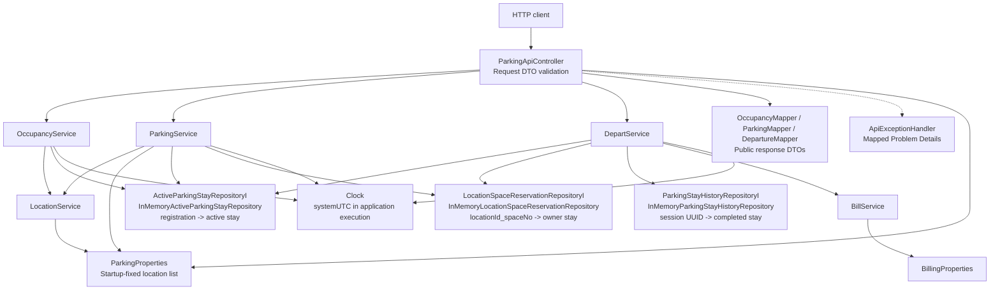
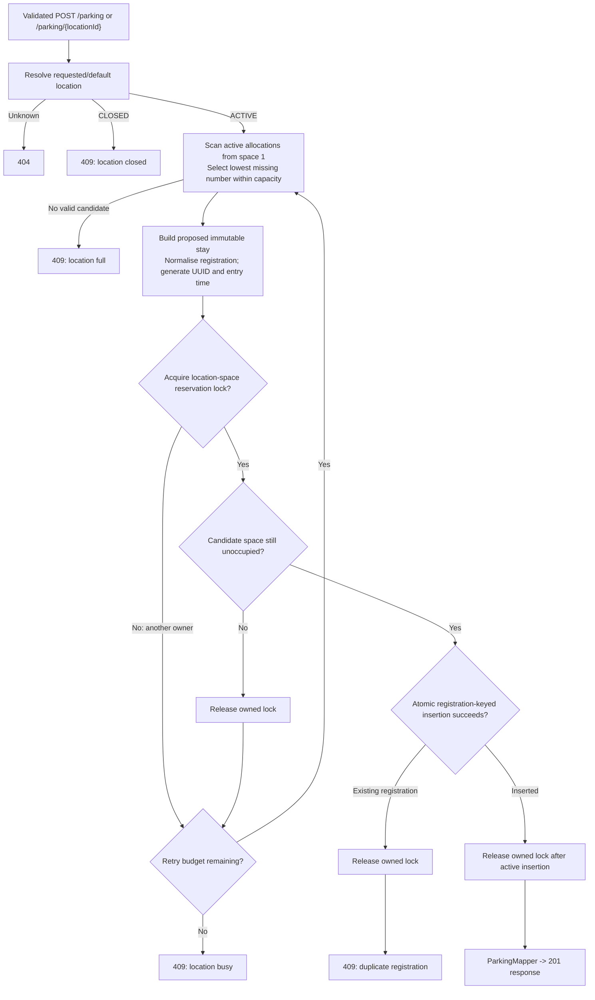
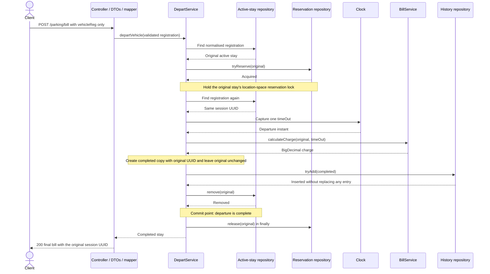

# Parking API — Solution Design

This document explains how I structured the parking API, the main trade-offs, and what I left out. Build, run and API details are in the [README](../README.md), together with my assumptions and the questions I would have asked.

## Scope

| Area | Brief | Implementation |
| --- | --- | --- |
| Endpoints | `GET /parking`, `POST /parking`, `POST /parking/bill` | All three, plus `GET` and `POST /parking/{locationId}` for configured locations. |
| Allocation | First available space | Lowest free space number, re-checked before the stay is stored. |
| Charging | £0.10/£0.20/£0.40 per minute, plus £1 every five minutes | Pro rata per second, rounded down to the penny, plus £1 per completed five minutes. |
| Storage | In memory only | Concurrent in-memory maps behind repository interfaces. |
| Concurrency | Optional | Parking and departure are safe under concurrent requests. |
| Packaging | Explain how to run locally | Java 21, Maven Wrapper and an executable JAR. No Docker. |

## Components



The controller validates request DTOs and delegates to the services. Mappers convert domain records into response DTOs, so the public contract is separate from the domain model. `ApiExceptionHandler` turns business exceptions into Problem Details responses (400, 404 or 409).

There are three repositories, each owning one map:

- **Active stays**, keyed by normalised registration. `putIfAbsent` stops a vehicle having two active stays.
- **Space reservations**, keyed by `locationId_spaceNo`. A short-lived entry acts as a lock on one space while parking or departure is in progress.
- **History** of completed stays, keyed by session UUID.

Locations come from startup configuration, so there is no location repository. A shared `Clock` bean supplies time, which lets tests control entry and exit times.

## Extensibility and flexibility

Domain models are separate from HTTP request and response DTOs, with mappers translating between them. This allows the API contract and business model to evolve independently. The current in-memory stores hold domain records directly; there are no database persistence entities. A future database implementation would introduce separate persistence entities and map them to and from the domain model, keeping database annotations and storage details out of the domain and public DTOs.

Services depend on repository interfaces. The current implementations are Spring-managed repository beans backed by concurrent in-memory structures, rather than Spring Data repositories. A database adapter could implement those interfaces and be supplied through dependency injection, keeping storage changes concentrated in the persistence layer and preserving the service-facing contracts.

The interfaces make that replacement easier, but a database implementation must preserve atomic insertion, conditional removal and reservation ownership. Supporting multiple application instances would also require database constraints and a transaction or distributed locking strategy for parking and departure. These guarantees would need integration tests against the chosen database.

## Parking



The service picks the lowest space number that has no active stay, reserves that space, checks again that it is still free, then stores the stay. The reservation is released in a `finally` block. The stay is stored before the reservation is released, so the space is never unprotected.

If another request holds the reservation or takes the space first, the service starts a fresh search. It allows one attempt plus five retries (configurable). If the retries run out it returns 409 "busy", which is different from 409 "full". Locking one space at a time means requests for different spaces or locations do not block each other.

## Departure and billing



Departure finds the active stay by registration, reserves its space, and confirms the same session is still active. It then captures one exit time, calculates the charge, adds the completed stay to history and removes the active stay. Removing the active stay is the commit point. If the removal fails, the history entry this request added is removed again. If the space is already reserved by another request, departure returns 409 straight away rather than retrying.

The charge is calculated in whole pence with `long` arithmetic:

```text
basePence      = (seconds * ratePencePerMinute) / 60
surchargePence = (seconds / 300) * 100
charge         = BigDecimal.valueOf(basePence + surchargePence, 2)
```

Both divisions round down. Overflow is checked with `Math.multiplyExact` and `addExact`. The value is converted to `double` only in the response, as the brief specifies.

| Duration | Small | Medium | Large |
| --- | --- | --- | --- |
| 59 seconds | £0.09 | £0.19 | £0.39 |
| 1 minute | £0.10 | £0.20 | £0.40 |
| 4 min 59 s | £0.49 | £0.99 | £1.99 |
| 5 minutes | £1.50 | £2.00 | £3.00 |
| 10 minutes | £3.00 | £4.00 | £6.00 |

Rates and the interval charge are set in `billing.properties`.

## Main trade-offs

| Area | Chosen | Alternative | Reason |
| --- | --- | --- | --- |
| Storage | Concurrent maps behind interfaces | H2 or another in-memory database | Meets the brief without schemas, and keeps atomic operations explicit. The interfaces allow a database later. |
| Concurrency | One reservation per space | A lock per location or a global lock | Requests for different spaces can run in parallel. No lock objects are kept for every space. |
| Money | Integer pence and `BigDecimal` | `double` arithmetic | Exact values and a clear rounding rule. |
| Stay updates | Immutable records; departure creates a completed copy | Changing the active stay in place | Other threads never see a half-updated stay. |
| Acceptance tests | Set up and check state through HTTP | Insert data straight into repositories | The tests use the API the way a client would. Internal failure paths are covered by unit tests. |

## Testing

- **Unit tests** (JUnit 5, AssertJ, Mockito) cover billing boundaries, repository behaviour, parking retries, and departure ordering and clean-up.
- **Acceptance tests** (Cucumber) run over real HTTP in a separate Maven module, with their own DTOs. An adjustable test clock sets entry and exit times.
- **Concurrent parking** has five scenarios that start requests together using a `CyclicBarrier`.
- **Test-first.** I wrote each slice test-first; the commit history shows failing acceptance scenarios committed before the code that makes them pass.

## Current limitations and deferred work

- Data is held in memory only. It is lost on restart, and separate instances do not share state.
- History has no size limit and grows for as long as the process runs.
- Location configuration is not validated at startup, for example for duplicate IDs or a missing default location.
- Validation errors return a general message rather than naming the field.
- Unexpected server errors use Spring's default error response, not Problem Details.
- Departure has one acceptance scenario. Concurrent departure is unit-tested but has no HTTP scenario.
- A request that hangs while holding a space reservation keeps that space locked until restart. There is no lease or timeout.

## Future extension options

- A database with unique constraints, or Redis `SET NX`, to replace the in-memory maps and support several instances.
- Scheduled clean-up of old history, for example with Quartz, coordinated with departures in progress.
- Docker packaging of the executable JAR.
- Field-level validation messages and a Problem Details handler for server errors.
- Endpoints for receipts, running charges and managing locations, if they are needed.
